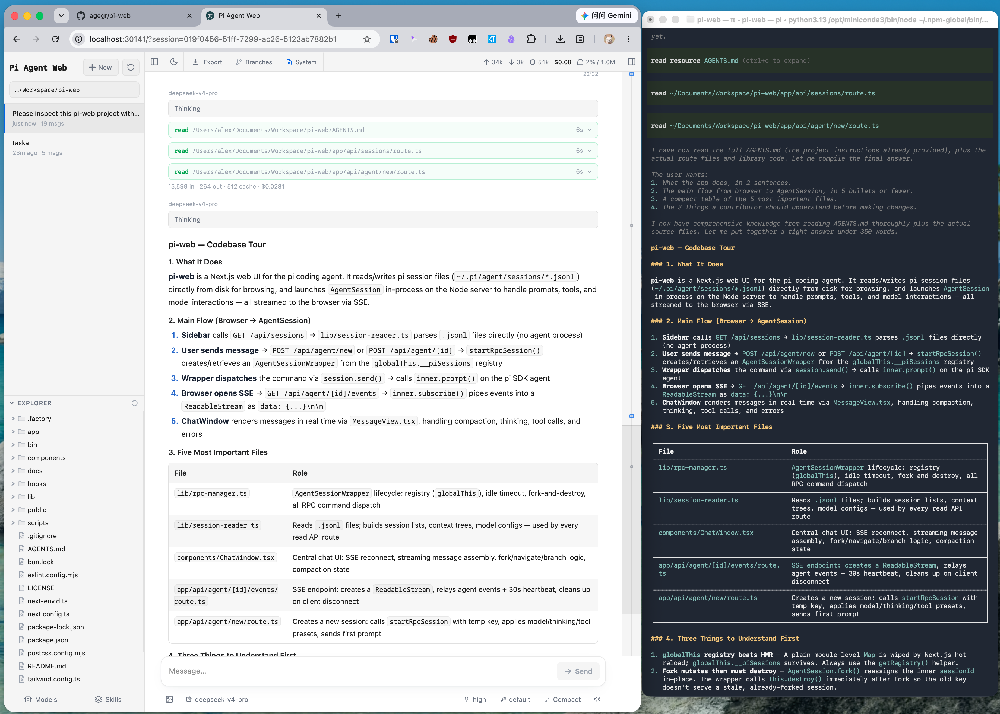

# Pi Web

[中文文档](./docs/README.zh-CN.md) | [日本語](./docs/README.ja.md) | [Русский](./docs/README.ru.md)

Local browser UI for the [pi coding agent](https://github.com/earendil-works/pi). Pi Web uses the same local configuration and session files as pi, so you can browse and resume conversations, run agent turns, configure models and resources, and inspect project files from a browser.

This is the **@silgrid/pi-web** fork of the upstream pi-web project, adding split-pane chat and background task panels. Pi Web is developed in the [Polyforge](https://github.com/silgrid/polyforge) repository's `pi-web/` directory and versioned by Polyforge's release tag (one tag for `pf` and Pi Web); it never reuses upstream version numbers.

## Polyforge

Pi Web is the web workbench of [Polyforge](https://github.com/silgrid/polyforge), a team-level multi-agent coordination and memory system for coding agents. With a local `pf` on the machine, Pi Web's Polyforge panel shows work items, jobs with their step graphs and execution progress, project memory and messages. Pi Web works without Polyforge; to install `pf`, follow the installer in the Polyforge README.

## Fork baseline

| Fork version | Upstream version | Upstream commit |
|---|---|---|
| 0.0.1 | 0.9.1 | `ffb2daf` |
| 0.0.4 | 0.9.1 | `1eb5e66` |
| 0.0.17 | 0.9.3 | `96966e5` (merge of piupstream/main) |
| 0.1.6 | 0.11.0 | `c9e1513` |
| 0.1.6 | 0.12.1 | `f83b1a5` |
| 0.1.6 | 0.12.2 | `b017cd4` |
| 0.1.6 | 0.13.0 | `d128bae` (merge `ca5fae9`) |
| 0.1.11 | 0.14.2 | `025e24e` (merge of piupstream/main) |

Upstream releases are taken by the prefix-diff procedure in [docs/upstream-tracking.md](./docs/upstream-tracking.md): one commit per upstream release, which adds that release's row here and updates `PROVENANCE.md` in the same commit, so the table stays the mapping between the fork line and the upstream baseline.



## Features

- **Session workspace**: browse, resume, rename, export, and delete conversations grouped by project, with running state, context usage, cost, and compaction details.
- **Two ways to branch**: **New session** creates an independent session file from an earlier message; **Edit from here** creates a branch inside the current session.
- **Project file tools**: browse and upload files, inspect Git diffs, and preview source, Markdown, images, audio, PDFs, and DOCX files with automatic refresh.
- **Web-based configuration**: manage provider login and API keys, models, model tests, plugin packages, and skills without leaving Pi Web.
- **Polyforge panel**: with a local `pf` on the machine, a topbar button opens a dock panel (a bottom sheet on phones) for Polyforge: Jobs cards and a job detail with its step graph and whole-job execution progress, Tasks, the 工单列表 work item list, project Memory, and Messages with project-grouped contacts and member management, a collapsible contact column, and a per-message analysis card (type, summary, and File ticket / Reply actions). See [docs/agents/polyforge-panel.md](docs/agents/polyforge-panel.md).
- **claude sessions**: a fresh composer's harness selector (pi or claude) sits beside its model selector, which lists the model aliases the claude on your PATH reports (such as `default`, `opus`, `sonnet`, `haiku`) plus any custom model names you add, when claude is chosen. Only the harness stays fixed: an open claude session switches its model and effort while idle and compacts with claude's own `/compact`. It runs the system claude with your own config, login and `CLAUDE.md` (a hint under the selectors says so) — no dedicated config dir and no tool presets. See [docs/agents/claude-sessions.md](docs/agents/claude-sessions.md).
- **English, Simplified Chinese, and Traditional Chinese UI**: Pi Web follows the browser language initially and provides a language switcher in the top bar.

## Quick Start

> **⚠️ Exposure warning.** `npx` / `pi-web` binds `127.0.0.1` only by default. `pi-web -H 0.0.0.0` / `npm run start:lan` expose the app **without authentication** unless `PI_WEB_PASSWORD` is set: anyone who can reach the port can read and write files, open a terminal, and drive the agent. `deploy-piweb.sh` defaults to `0.0.0.0`, but it now refuses a non-loopback bind unless both `PIWEB_PORT` and `PI_WEB_PASSWORD` are set, so it cannot start a passwordless service. Set `PI_WEB_PASSWORD` (or keep the loopback bind / front it with a trusted edge) before exposing the port.

Pi Web requires Node.js 22.19.0 or newer. Check your version with `node --version`, then run:

```bash
npx @silgrid/pi-web@latest
```

The CLI opens a browser after the server is ready. If it does not, open [http://127.0.0.1:30141](http://127.0.0.1:30141). Pi Web listens only on `127.0.0.1` by default.

If no model provider is configured yet, open the **Models** panel to sign in or add an API key.

To install the `pi-web` command globally:

```bash
npm install -g @silgrid/pi-web@latest
node "$(npm root -g)/@silgrid/pi-web/bin/pi-web-install-check.js"
pi-web
```

The second line confirms the package's install scripts took effect: npm can skip install scripts and still exit 0 (e.g. npm 11 under `ignore-scripts` or an explicit `allowScripts` denial; at default settings it runs unreviewed scripts with a notice), so the check runs the postinstall steps itself, starts one terminal through `node-pty` (rebuilding it with its install scripts allowed when it cannot), and exits non-zero naming the step that failed.

Commands:

```bash
pi-web version          # print the installed version
pi-web status           # list running servers
pi-web stop [--port N]  # stop a running server
pi-web open [--port N]  # open a running server in the browser
pi-web update [--check] # update a global install from its release channel
```

To update, stop the running process with `Ctrl+C` and run `pi-web update`. It updates from the release channel named in the shipped `bin/pi-web-release-channel.json` (`{ "repo": "OWNER/REPO" }`): when that is this package's own repository (`silgrid/pi-web`) it installs `@silgrid/pi-web@latest` from npm, the same as running the install command again; any other repository is a GitHub Releases line, updated from that repository's GitHub Releases (the GitHub CLI `gh` downloads the release `.tgz` and `SHA256SUMS`, the checksum is verified, then `npm install -g` installs the tarball). `pi-web update --check` only reports the channel and the latest version; it downloads and installs nothing. A tree without a valid marker (for example an upstream or copied package) is refused with a non-zero exit before anything is fetched or installed. This tree's marker names the Polyforge repository: each Polyforge release carries the Pi Web tarball (`silgrid-pi-web-<tag>.tgz`) and `SHA256SUMS` next to `pf`, so `pi-web update` follows the same tag as `pf`. To uninstall, run `npm uninstall -g @silgrid/pi-web`.

## Deployment (container autostart)

This fork ships a deployment script for containers without systemd:

```bash
./deploy-piweb.sh   # npm i -g @silgrid/pi-web@latest, then restart the tmux service
```

The script installs the latest published package globally, confirms its install
scripts took effect (below), and (re)starts pi-web in a detached `tmux` session (`piweb`) with a restart loop. `PI_WEB_IDLE_TIMEOUT_MS=0`
is required for unattended runs: by default pi-web exits after 10 idle minutes,
which looks like the process "self-exits" when run as a background service.

Right after `npm install -g`, the deploy runs the installed package's own
install check, `bin/pi-web-install-check.js` under `npm root -g`: npm can skip
install scripts and still exit 0 (e.g. npm 11 under `ignore-scripts` or an
explicit `allowScripts` denial; at default settings it runs unreviewed scripts
with a notice), so the check runs the postinstall steps itself (`patch-package`, then
`node bin/prepare-terminal.js`), starts one terminal through `node-pty`, and,
when that fails, rebuilds `node-pty` with its install scripts explicitly
allowed (`npm rebuild node-pty --ignore-scripts=false --dangerously-allow-all-scripts`)
and probes again. Each step prints `==> Install check: <step> ok`. A failure
prints `ERROR: Pi Web install check failed at <step>: <reason>` and exits 1
before any tmux window is touched, so the old service keeps running; an npm
that reports no global root, or a package without the checker, fails the same
way.

### Service shape (`~/.config/piweb/deploy.env`)

The script takes the service shape from the caller's environment and fills any
variable the caller did not set from the operator's
`~/.config/piweb/deploy.env` (mode `0600`). The file is parsed as plain
`KEY=VALUE` lines: it is never sourced or executed, and only these keys are
read:

| Key | Meaning |
| --- | --- |
| `PIWEB_PORT` | Port passed to pi-web; required for a non-loopback bind |
| `PIWEB_HOST` | Bind address (default `0.0.0.0`) |
| `PI_WEB_PASSWORD` | Web-auth password; required for a non-loopback bind |
| `PI_WEB_ALLOWED_HOSTS` | Comma-separated hostnames pi-web accepts |
| `PIWEB_INSTALL_REPO` | GitHub Releases install channel: `OWNER/REPO` |
| `PIWEB_INSTALL_VERSION` | Exact release tag to install (optional pin) |

A value set in the caller's environment wins over the file, including an
explicitly empty value. The script logs only the names of the keys it loaded,
never their values.

An unquoted value ends at whitespace followed by `#`: `PIWEB_PORT=8142  # the
service port` loads `8142`. A quoted value keeps its content, `#` included
(`PI_WEB_PASSWORD="a#b"` loads `a#b`). The file holds the web-auth password:
when it is not mode `0600` or not owned by the deploying user, the deploy
still uses it and prints one `warn:` line naming the file, its mode and owner
(never a value).

A non-loopback bind is refused before any install or tmux change unless both
`PIWEB_PORT` and `PI_WEB_PASSWORD` are set (in the environment or the file).
The error names the missing variables and the old service keeps running.

After the swap, a deploy that has both `PIWEB_PORT` and `PI_WEB_PASSWORD` probes
the configured port: `GET /login` must answer 200, an anonymous
`GET /api/sessions` must answer 401, and an authenticated `GET /` must answer a
non-5xx, all within 20 seconds. The probe logs in with
`POST /api/web-auth` and a session cookie (Basic auth only works on API
paths), writing the password-bearing JSON body to a temporary `0600` file from
stdin so it never appears on a command line or in a log. A failed probe exits
3, so the deploy lane reports `state=changed` instead of `state=deployed`; an
unreachable, unauthenticated or broken-logged-in service is never reported as
a successful deploy. The probe needs `curl` on the deploy host (a script
dependency, next to `bash`, `tmux`, `npm` and `node`): without it the probe
fails at once with an error naming `curl` (exit 3, `state=changed`) instead of
blaming the service. The probe runs only when both `PIWEB_PORT` and
`PI_WEB_PASSWORD` are set, so a loopback deploy with a port but no password
gets no reachability check.

The deploy then checks that the pi-web it serves is the pi-web it just
installed. The restart-loop command puts the global install's `bin` directory
first on its own `PATH`, so neither the deploy caller's `PATH` nor a later
`tmux respawn-window` from a hostile shell decides which package runs.
Everything pi-web spawns (agent shell sessions included) then resolves through
that same prefix-first `PATH`, so same-named tools from the installed prefix
can shadow ones later on the caller's `PATH`.
After the loop's first process is up, the package directory the loop's Next.js
server process runs in (its working directory) must equal the package npm
just wrote under its global root
(`npm root -g`), **directory and version**, compared up to 3 times within 30
seconds. A mismatch — including an old prefix that happens to carry the same
version — prints the served and installed packages and exits 3, so the lane
reports `state=changed`, never `state=deployed`. When the packages agree the deploy prints
`==> Served == installed: pi-web <version> (<path>)`.

The same loop command also pins the `pf` the service will run. The deploy
takes a non-empty `PF_BIN` from the deploying shell, else the tmux server's
global `PF_BIN`, else `pf` found on the loop's pinned `PATH`, sets that value
on the loop's own environment, and prints exactly one line:
`==> pf: <absolute path> (<pf --version>)`. A later hostile
`tmux respawn-window` therefore cannot drop pf either, and the printed line
names what the service actually uses. When no pf is found, or a configured
`PF_BIN` is not executable, the deploy prints
`==> pf: none found (<reason>)` instead; the Polyforge panel then reports
"not installed" until a pf is installed or `PF_BIN` is set correctly.

The deploy then probes the TLS edge of the first `PI_WEB_ALLOWED_HOSTS` entry
with a single `https` `GET /` (5-second timeout; any HTTP answer, a redirect
included, counts as reachable). The edge (e.g. a reverse proxy) is a separate
service, so a failure only prints `warn: TLS edge unreachable (<host>)`: the
exit code is unchanged and the deploy lane still reports `state=deployed`. An
empty `PI_WEB_ALLOWED_HOSTS` skips the edge probe with one line naming it,
`warn: TLS edge probe skipped: PI_WEB_ALLOWED_HOSTS is not set (no edge host to probe)`,
and so does a host without `curl`: `warn: TLS edge probe skipped: curl is not installed (<host>)`.

For container entrypoint autostart, create the tmux session at container start
(e.g. from an entrypoint script or shell rc):

```bash
tmux new-session -d -s piweb 'PI_WEB_IDLE_TIMEOUT_MS=0 pi-web'
```

Override the session name with `PIWEB_TMUX_SESSION`; attach with `tmux attach -t piweb`.

To reach pi-web from a phone or another network without running your own edge,
see [Expose pi-web to your phone](#expose-pi-web-to-your-phone) — the deploy
script ships opt-in exposure modes (`PIWEB_EXPOSE=lan|tailscale|cloudflare`).

## Configuration

For port and hostname, command-line options override the corresponding environment variables. Either `--no-open` or `PI_WEB_NO_OPEN=1` disables automatic browser opening. Run `pi-web --help` (or `-h`) to print startup options and exit without starting the server. Unknown options exit with an error.

| Option or environment variable | Purpose | Default |
| --- | --- | --- |
| `--help`, `-h` | Print startup options and exit | — |
| `--port <port>`, `-p <port>`, or `PORT` | Server port | `30141` |
| `--hostname <host>`, `-H <host>`, or `PI_WEB_HOSTNAME` | Bind hostname | `127.0.0.1` |
| `--no-open` or `PI_WEB_NO_OPEN=1` | Do not open a browser automatically | Browser opens |
| `PI_WEB_APP_NAME` | PWA manifest `name` and `short_name`; surrounding whitespace is trimmed, empty values use the default | `Pi Web` |
| `PI_WEB_SKIP_VERSION_CHECK=1` | Disable Pi Web update checks | Unset |
| `PI_WEB_ALLOWED_HOSTS` | Additional exact proxy or custom hostnames, comma-separated | Unset |
| `PI_WEB_PASSWORD` | Enable browser password login; API clients may use Basic Auth with username `pi` | Authentication disabled |
| `PI_WEB_IDLE_TIMEOUT_MS` | Session idle timeout in milliseconds, up to `2147483647`; `0` disables idle shutdown; invalid or out-of-range values use the default. An open page renews its session every 30 s, so a value below 30 s ends an idle session between renewals (a running turn or background task keeps it alive), and the next stream open resumes it | `600000` (10 min) |
| `PI_WEB_PUSH_ALLOWED_ENDPOINT_SUFFIXES` | Additional Web Push endpoint host suffixes (comma-separated) accepted by `/api/push/subscribe`, on top of the built-in browser push services (FCM, Mozilla autopush, Apple) | Unset |
| `PI_WEB_SHUTDOWN_DEADLINE_MS` | How long extensions get to handle `session_shutdown` before a closing session is disposed anyway, in milliseconds up to `2147483647`; `0`, invalid or out-of-range values use the default | `5000` (5 s) |
| `PI_CODEMODE_MAX_WORKERS` | pi's limit on codemode scripts running at once, shared by every session and subagent in the server; pi's own default is `2`, and pi-web sets `8` when the variable is unset or empty. Each script may use up to 256 MB | `8` |

Set `PI_WEB_APP_NAME` before starting the server (for example, `PI_WEB_APP_NAME='Work Pi' pi-web`). After changing it, restart the server to serve the new manifest; no rebuild is required. Updates to the name of an already installed PWA are managed by the browser and are not guaranteed to appear immediately. This does not change the page title or icons.

For example:

```bash
pi-web --help
pi-web -p 8080 -H 0.0.0.0 --no-open
```

### Remote Access

Binding to a non-loopback address exposes an agent that can execute high-privilege actions. On a trusted LAN, require a long random password:

```bash
PI_WEB_PASSWORD='a-long-random-password' pi-web --hostname 0.0.0.0
```

Password authentication does not encrypt the connection. Do not expose Pi Web over plain HTTP to the internet; use HTTPS through a trusted reverse proxy or a trusted VPN. If a reverse proxy sends an external hostname, add that exact name to `PI_WEB_ALLOWED_HOSTS`. This allow-list does not change the address Pi Web binds to.

For turnkey HTTPS exposure without your own reverse proxy, see [Expose pi-web to your phone](#expose-pi-web-to-your-phone) below.

### Docker

Each release publishes an image to `ghcr.io/agegr/pi-web`. See [Running Pi Web in Docker](./docs/docker.md) for it, the Compose example and which volumes to keep.

### HTTP Proxy

Server-side model and API requests honor the standard `HTTP_PROXY`, `HTTPS_PROXY`, and `NO_PROXY` environment variables.

On macOS or Linux:

```bash
HTTP_PROXY=http://127.0.0.1:7890 \
HTTPS_PROXY=http://127.0.0.1:7890 \
NO_PROXY=localhost,127.0.0.1 \
npx @silgrid/pi-web@latest
```

On Windows PowerShell:

```powershell
$env:HTTP_PROXY = "http://127.0.0.1:7890"
$env:HTTPS_PROXY = "http://127.0.0.1:7890"
$env:NO_PROXY = "localhost,127.0.0.1"
npx @silgrid/pi-web@latest
```

## Expose pi-web to your phone

`deploy-piweb.sh` ships opt-in exposure modes: set `PIWEB_EXPOSE=lan|tailscale|cloudflare` when deploying. Every exposed mode binds a non-loopback address, so the script refuses to deploy unless `PIWEB_PORT` and `PI_WEB_PASSWORD` are set — the examples below read them from `~/.config/piweb/deploy.env`, or you can prefix them on the command line. Leaving `PIWEB_EXPOSE` **unset** keeps the legacy self-managed deployment shape — pi-web binds `0.0.0.0` and you run your own edge (the GCP static-IP + Caddy setup, for example), with `PI_WEB_ALLOWED_HOSTS` passed through untouched and no tunnel/serve tooling installed — but the same fail-closed guard still requires `PIWEB_PORT` and `PI_WEB_PASSWORD`.

| Situation | Mode | Result |
| --- | --- | --- |
| You already manage an edge (GCP + Caddy, own reverse proxy) | *unset* | `0.0.0.0:<port>`; edge and certs are yours |
| Phone on the same WiFi as the host | `PIWEB_EXPOSE=lan` | Direct `http://<host-LAN-IP>:<port>` — zero extra tooling |
| Your own devices, on any network ⭐ | `PIWEB_EXPOSE=tailscale` | `https://<machine>.<tailnet>.ts.net` with an auto Let's Encrypt cert (recommended) |
| Sharing with many people at scale | `PIWEB_EXPOSE=cloudflare` + `PIWEB_TUNNEL=named` | Public hostname over an outbound-only Cloudflare tunnel |
| Just kicking the tires | `PIWEB_EXPOSE=cloudflare` + `PIWEB_TUNNEL=quick` | Random `*.trycloudflare.com` URL — **demo only** |

```bash
# PIWEB_PORT and PI_WEB_PASSWORD come from ~/.config/piweb/deploy.env, or add
# them to any line below (e.g. PI_WEB_PASSWORD='...' PIWEB_PORT=8142 ...).
# Same WiFi only
PIWEB_EXPOSE=lan ./deploy-piweb.sh

# Recommended for personal use: your devices, anywhere (5G, roaming)
PIWEB_EXPOSE=tailscale ./deploy-piweb.sh

# Cloudflare: named tunnel (stable public hostname) or quick tunnel (demo)
PIWEB_EXPOSE=cloudflare PIWEB_TUNNEL=quick ./deploy-piweb.sh
PIWEB_EXPOSE=cloudflare PIWEB_TUNNEL=named \
  PIWEB_CF_CONFIG=/etc/cloudflared/config.yml \
  PIWEB_CF_HOSTNAME=pi.example.com ./deploy-piweb.sh
```

Any other `PIWEB_EXPOSE` value fails fast, before the script uninstalls, installs, or restarts anything.

### LAN mode

Zero extra tooling: pi-web stays reachable at `http://<host-LAN-IP>:<port>` on the local network, and nothing is appended to `PI_WEB_ALLOWED_HOSTS`. One cleartext caveat to know (the script states it, it cannot fix it):

- PWA install degrades over HTTP — Chrome may not offer “Install app”. (Chrome app-mode windows — the mac/Windows `piweb` launcher — open `http://` origins fine.)

### Tailscale mode (recommended)

Installs Tailscale when absent (macOS via Homebrew, Linux via the upstream install script), runs `tailscale up` (SSO login), and mounts pi-web at `https://<machine>.<tailnet>.ts.net` through `tailscale serve` with an auto-provisioned Let's Encrypt cert — no domain, no ports, no Caddy.

The ts.net HTTPS origin satisfies **both** mobile clients on one origin: the Chrome PWA install criteria on Android and Safari Add-to-Home-Screen on iOS. `tailscale serve` runs as a tmux window of the deploy session, so killing the session stops it; redeploys keep a serve mapping that already forwards to the current port, and replace the serve holder window otherwise (a healthy serve survives a redeploy).

Node sharing (share this machine with family/colleagues' tailnet accounts) covers the "people I trust" case; public sharing needs Cloudflare mode or Tailscale Funnel (not automated by this script).

### Cloudflare mode

`cloudflared` runs outbound-only — no inbound ports. `PIWEB_TUNNEL=quick` (default) starts a quick tunnel and prints its `*.trycloudflare.com` URL, captured and wired into `PI_WEB_ALLOWED_HOSTS` automatically. **Quick-tunnel URLs are demo-only**: reusing a healthy connector keeps the URL stable across redeploys, but the connector restarting (or dying) still mints a fresh one — never bake one into a PWA or app-mode client.

`PIWEB_TUNNEL=named` is for public distribution at scale. It requires a Cloudflare account with your domain on Cloudflare DNS and two operator-supplied settings:

- `PIWEB_CF_CONFIG` — your `cloudflared` `config.yml` (tunnel ID, credentials-file, and an ingress entry mapping your hostname to `http://127.0.0.1:<port>`)
- `PIWEB_CF_HOSTNAME` — the public ingress hostname to allow

The cloudflared process runs as a tmux window of the deploy session; a redeploy keeps a healthy connector that forwards to the current port running (its PID — and the quick URL — survive), and replaces it only when it is stale or dead, so redeploys don't accumulate tunnels.

### Common behavior in exposed modes

- In `tailscale`/`cloudflare` modes the served/tunnel hostname is appended to `PI_WEB_ALLOWED_HOSTS` before pi-web starts (operator entries are preserved and come first) — otherwise request-security rejects the unknown `Host` header. `lan` mode and the unset path append nothing.
- Serve/tunnel lifecycle is tied to the `${PIWEB_TMUX_SESSION:-piweb}` tmux session: killing it stops the tunnel. Re-running the script is tunnel-idempotent — only the pi-web loop window(s) are recycled (unnamed loop windows left by older deploys or the autostart recipe included); a serve/tunnel window that is alive and forwarding to the current port survives with its process (and the quick URL, recovered from `~/.piweb/<session>-quick-tunnel.log`), and a stale or dead one is replaced, window included.
- Phone client: install the PWA over the HTTPS origin — Android: Chrome → Install app; iPhone: Safari → Share → Add to Home Screen.

### China notes

- **Tailscale SSO**: sign in with GitHub or Apple — Google login does not work in mainland China.
- **Tailscale connectivity**: generally usable in mainland China; direct connections are preferred, with DERP relay as fallback.
- **Android**: Chrome WebAPK minting and closed-app Web Push go through Google/FCM and need a VPN on mainland networks.
- **iOS**: PWA Web Push uses APNs and works in mainland China without a VPN.

## Clients

Every platform opens the same self-hosted origin — no bundled server, no proxying, no script injection:

| Platform | Standalone form | Install path |
|---|---|---|
| macOS | Chrome app mode — `piweb` alias | shell rc file (see [`docs/mobile.md`](./docs/mobile.md)) |
| Windows | Chrome app mode — `piweb` function | PowerShell profile (see [`docs/mobile.md`](./docs/mobile.md)) |
| iPhone | Safari PWA — the native standalone form on iOS | Safari → Share → Add to Home Screen |
| Android | Chrome PWA — for now | Chrome → ⋮ → Install app |

Closed-app Web Push on Android goes through FCM, which needs a VPN in mainland China — see the launcher snippets, the China reachability notes and the full notification capability matrix in [`docs/mobile.md`](./docs/mobile.md).

## Notes

- **Agent data**: Pi Web reads pi data from `~/.pi/agent` by default, including session files under `sessions/<encoded-cwd>/<timestamp>_<uuid>.jsonl`. Set `PI_CODING_AGENT_DIR` to use another pi agent directory.
- **Filesystem access**: Pi Web must be able to read the agent data directory and the working directories recorded by its sessions. Run Pi Web in the same filesystem environment as pi when sharing existing sessions.
- **Shared configuration**: the Models panel uses pi's model, settings, and credential storage, so changes are visible to both interfaces. An open session applies a saved edit of its model when you select the model again.
- **File access boundary**: the file browser is limited to working directories selected in Pi Web and project or session roots it already knows about; it is not a general filesystem browser.

### Downstream Session Context Menu

Electron wrappers and other downstream integrations can provide a session-row
context menu without patching `SessionSidebar`. Listen for the cancelable
`pi-web:session-row-contextmenu` browser event and call `preventDefault()`
synchronously when the integration will handle it:

```js
window.addEventListener("pi-web:session-row-contextmenu", (event) => {
  event.preventDefault();
  const { id, path, cwd, name, clientX, clientY, refresh } = event.detail;

  void openSessionMenu({ id, path, cwd, name, clientX, clientY }).then((changed) => {
    if (changed) refresh();
  });
});
```

The detail object contains `id`, `path`, `cwd`, optional `name`, pointer
coordinates, and a `refresh()` callback for actions that change the session
list. If no listener cancels the extension event, Pi Web preserves the
browser's native context menu. This hook is browser-side and independent of
Pi agent extensions.

### Extension Session Liveness

Server-side Pi extensions with detached work can prevent automatic idle
session eviction through the versioned global registry:

```js
// Projection grep exemption: the key's literal spelling names
// the upstream package, so this sample reaches it only through the exported
// SESSION_LIVENESS_REGISTRY_KEY and Symbol.for(...); never paste the literal.
// SESSION_LIVENESS_REGISTRY_KEY: the registry key string exported by
// lib/session-liveness.ts (the upstream-compatible v1 key); use its value.
const liveness = globalThis[Symbol.for(SESSION_LIVENESS_REGISTRY_KEY)];
const release = liveness?.version === 1
  ? liveness.register({
      name: "my-extension",
      sessionId,
      sessionFile: sessionFile || undefined,
      isActive: () => detachedJobs.size > 0,
    })
  : () => {};
```

Register once per active extension session and call the returned idempotent
`release` function on session shutdown, replacement, or reload. `isActive`
must be synchronous, cheap, and scoped to the supplied exact session id or
file. Provider errors fail safe by preserving that session. This lease only
affects automatic idle eviction; explicit shutdown and Stop fallback cleanup
still take precedence.

## Development

```bash
npm install
npm run dev
```

The development server runs at [http://127.0.0.1:30141](http://127.0.0.1:30141). Run the common checks with:

```bash
npm test
node_modules/.bin/tsc --noEmit
npm run lint
```

`npm test` runs the tests with a private temp dir and fails if anything is left in it afterwards (`scripts/tmp-guard.mjs`): a test removes what it creates, in `t.after()`. It also clears every `PI_WEB_*` and `PF_*` variable and runs the tests with a temp HOME and XDG config dir, so a test never sees the runner's settings or pf config. A direct `node --test <file>` is isolated the same way by each test file's first import, `import "#test-env";` (`scripts/test-env-setup.mjs`); a new test file must import it first, or `lib/test-env-direct-run.test.mjs` fails.

Do not run `next build` or `npm run build` during normal development. It writes to `.next/` and can interfere with the development server; leave builds for release work.

Before starting on a feature, read [Contributing](./CONTRIBUTING.md) for what is in scope and the pull request checklist.

Contributor guides: [Internationalization](./docs/i18n.md) and [Release process](./docs/release.md).

## Repository Layout

```text
app/             Next.js UI and API routes
components/      React UI components
hooks/           Client state and interaction hooks
lib/             Session, agent, model, file, Git, and security logic
public/          Static assets and PWA files
bin/             npm CLI entrypoint and launch option parsing
scripts/         Development scripts (the npm test temp guard and test environment setup); not published
docs/            Focused user and contributor guides
```

See [AGENTS.md](./AGENTS.md) for the architecture notes and detailed file map.

## License

[MIT](./LICENSE)
