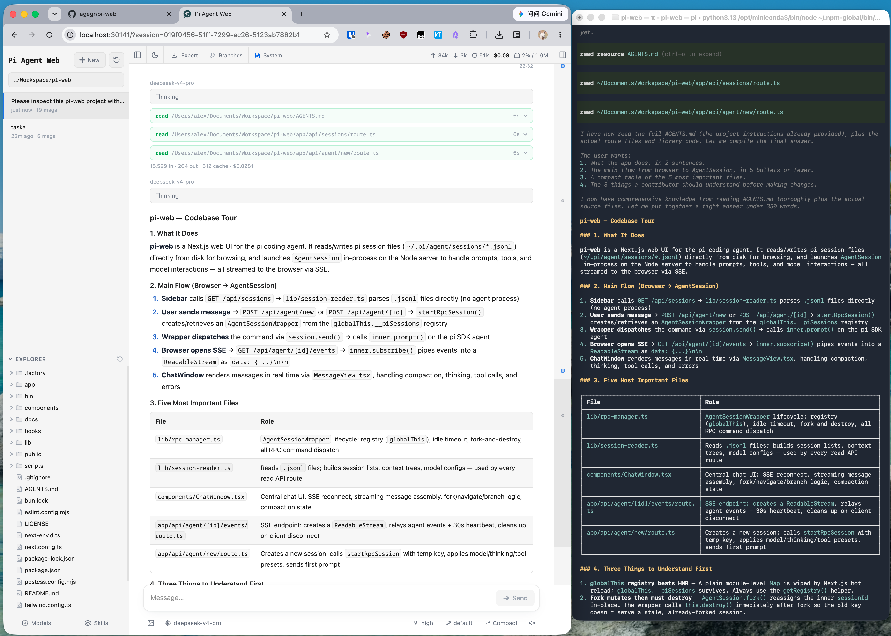

# Pi Web

[English](../README.md) | [简体中文](./README.zh-CN.md) | [Русский](./README.ru.md)

[pi コーディングエージェント](https://github.com/earendil-works/pi) のローカルブラウザー UI です。Pi Web は pi と同じローカル設定とセッションファイルを使用し、ブラウザーから会話の検索と再開、エージェントの実行、モデルやリソースの設定、プロジェクトファイルの確認を行えます。




## Polyforge

Pi Web は [Polyforge](https://github.com/silgrid/polyforge) の Web ワークベンチです。Polyforge はコーディングエージェント向けのチーム単位のマルチエージェント協調・メモリシステムです。マシンにローカルの `pf` があると、Pi Web の Polyforge パネルでワークアイテム、ステップグラフと実行進捗付きのジョブ、プロジェクトメモリ、メッセージを確認できます。Pi Web は Polyforge なしでも動作します。`pf` のインストールは Polyforge README のインストーラーの手順に従ってください。

## 機能

- **セッションワークスペース**：プロジェクトごとに会話を閲覧、再開、名前変更、エクスポート、削除し、実行状態、コンテキスト使用量、コスト、コンパクション情報を確認できます。
- **2 種類の分岐**：**New session** は以前のメッセージから独立したセッションファイルを作成し、**Edit from here** は現在のセッション内にブランチを作成します。
- **プロジェクトファイルツール**：ファイルの閲覧とアップロード、Git Diff の確認、ソース、Markdown、画像、音声、PDF、DOCX のプレビューに対応し、変更時は自動更新されます。
- **Web での設定**：Pi Web を離れずに、Provider のログインと API Key、モデル、モデルテスト、プラグインパッケージ、スキルを管理できます。
- **Polyforge パネル**：マシンに `pf` があれば、トップバーのボタンで Polyforge ドックパネル（スマートフォンでは下部シート）が開きます。Jobs カードとジョブ詳細（ステップグラフとジョブ全体の実行進捗）、Tasks、工単リスト（工单列表）、プロジェクトの Memory、プロジェクトごとに連絡先をまとめメンバー管理もでき、連絡先列を折りたためて、メッセージごとに分析カード（種別・要約と「建票」「返信」の操作）を出せる Messages を扱えます。詳しくは [agents/polyforge-panel.md](./agents/polyforge-panel.md) を参照してください。
- **claude セッション**：新しいコンポーザーではハーネス選択（pi または claude）がモデル選択の隣にあり、claude を選ぶとモデル選択に PATH 上の claude が報告するモデルのエイリアス（`default`、`opus`、`sonnet`、`haiku` など）と、追加したカスタムモデル名が並びます。固定なのはハーネスだけです。開いている claude セッションはアイドル中にモデルと effort を切り替えられ、claude 自身の `/compact` でコンパクトします。システムの claude を、あなた自身の設定・ログイン・`CLAUDE.md` で実行します（選択の下にその旨のヒントが出ます）。専用の設定ディレクトリやツールプリセットはありません。詳しくは [agents/claude-sessions.md](./agents/claude-sessions.md) を参照してください。
- **英語、簡体字中国語、繁体字中国語の UI**：初回はブラウザーの言語に従い、トップバーから言語を切り替えられます。

## クイックスタート

> **⚠️ 公開に関する警告。** `npx` / `pi-web` はデフォルトで `127.0.0.1` のみをリッスンします。`pi-web -H 0.0.0.0` / `npm run start:lan` は `PI_WEB_PASSWORD` を設定しない限り**認証なし**でアプリを公開します。ポートに到達できる人は誰でも、ファイルの読み書き、ターミナルの起動、エージェントの操作ができます。`deploy-piweb.sh` はデフォルトで `0.0.0.0` にバインドしますが、`PIWEB_PORT` と `PI_WEB_PASSWORD` の両方がない非ループバックへのデプロイを拒否するようになったため、パスワードなしのサービスを起動することはありません。ポートを公開する前に、`PI_WEB_PASSWORD` を設定するか、ループバックへのバインドを維持するか、信頼できるエッジ（リバースプロキシ）越しに公開してください。

Pi Web には Node.js 22.19.0 以降が必要です。`node --version` でバージョンを確認してから、次を実行します：

```bash
npx @silgrid/pi-web@latest
```

サーバーの準備が整うと、CLI はブラウザーを自動的に開こうとします。開かない場合は [http://127.0.0.1:30141](http://127.0.0.1:30141) にアクセスしてください。Pi Web はデフォルトで `127.0.0.1` のみをリッスンします。

モデル Provider が未設定の場合は、**Models** パネルを開いてログインするか API Key を追加してください。

`pi-web` コマンドをグローバルにインストールする場合：

```bash
npm install -g @silgrid/pi-web@latest
pi-web
```

コマンド：

```bash
pi-web version          # インストール済みのバージョンを表示
pi-web status           # 実行中のサーバーを一覧表示
pi-web stop [--port N]  # 実行中のサーバーを停止
pi-web open [--port N]  # 実行中のサーバーをブラウザーで開く
pi-web update [--check] # リリースチャネルからグローバルインストールを更新
```

更新するには、実行中のプロセスを `Ctrl+C` で停止してから `pi-web update` を実行します。同梱の `bin/pi-web-release-channel.json`（`{ "repo": "OWNER/REPO" }`）が指定するリリースチャネルから更新します。それがこのパッケージ自身のリポジトリ（`silgrid/pi-web`）の場合は npm から `@silgrid/pi-web@latest` をインストールし、インストールコマンドの再実行と同じ結果になります。それ以外のリポジトリは GitHub Releases ラインとして、そのリポジトリの GitHub Releases から更新します（GitHub CLI `gh` がリリースの `.tgz` と `SHA256SUMS` をダウンロードし、チェックサムを検証してから `npm install -g` で tarball をインストールします）。`pi-web update --check` はチャネルと最新バージョンを報告するだけで、何もダウンロードもインストールもしません。有効なマーカーのないツリー（上流やコピーされたパッケージなど）は、何かを取得・インストールする前に非ゼロの終了コードで拒否されます。このツリーのマーカーは Polyforge リポジトリを指します。Pi Web はそのリポジトリの `pi-web/` ディレクトリで開発され、Polyforge の各リリースには `pf` と並んで Pi Web の tarball（`silgrid-pi-web-<tag>.tgz`）と `SHA256SUMS` が含まれるため、`pi-web update` は `pf` と同じタグに従います。アンインストールするには `npm uninstall -g @silgrid/pi-web` を実行します。

## 設定

ポートとホスト名では、コマンドラインオプションが対応する環境変数より優先されます。`--no-open` と `PI_WEB_NO_OPEN=1` は、どちらを指定してもブラウザーの自動起動が無効になります。`pi-web --help`（または `-h`）で起動オプションを表示して終了します。未知のオプションはエラーで終了します。

| オプションまたは環境変数 | 用途 | デフォルト |
| --- | --- | --- |
| `--help`、`-h` | 起動オプションを表示して終了 | — |
| `--port <port>`、`-p <port>`、または `PORT` | サーバーポート | `30141` |
| `--hostname <host>`、`-H <host>`、または `PI_WEB_HOSTNAME` | バインドするホスト名 | `127.0.0.1` |
| `--no-open` または `PI_WEB_NO_OPEN=1` | ブラウザーを自動的に開かない | 自動的に開く |
| `PI_WEB_ALLOWED_HOSTS` | 追加で許可するプロキシまたはカスタムホスト名。複数指定はカンマ区切りで完全一致 | 未設定 |
| `PI_WEB_PASSWORD` | ブラウザーのパスワードログインを有効化。API はユーザー名 `pi` の Basic Auth も利用可能 | 認証なし |

例：

```bash
pi-web --help
pi-web -p 8080 -H 0.0.0.0 --no-open
```

### リモートアクセス

ループバック以外のアドレスにバインドすると、高い権限の操作を実行できるエージェントがネットワークに公開されます。信頼できる LAN で使用する場合も、十分に長いランダムなパスワードを設定してください：

```bash
PI_WEB_PASSWORD='十分に長いランダムなパスワード' pi-web --hostname 0.0.0.0
```

パスワード認証は接続を暗号化しません。平文 HTTP で Pi Web をインターネットに公開せず、信頼できるリバースプロキシによる HTTPS または信頼できる VPN を使用してください。リバースプロキシが外部ホスト名を転送する場合は、その名前を完全一致で `PI_WEB_ALLOWED_HOSTS` に追加します。この許可リストは Pi Web のバインド先を変更しません。

### HTTP プロキシ

サーバー側のモデルリクエストと API リクエストは、標準の `HTTP_PROXY`、`HTTPS_PROXY`、`NO_PROXY` 環境変数を使用します。

macOS または Linux：

```bash
HTTP_PROXY=http://127.0.0.1:7890 \
HTTPS_PROXY=http://127.0.0.1:7890 \
NO_PROXY=localhost,127.0.0.1 \
npx @silgrid/pi-web@latest
```

Windows PowerShell：

```powershell
$env:HTTP_PROXY = "http://127.0.0.1:7890"
$env:HTTPS_PROXY = "http://127.0.0.1:7890"
$env:NO_PROXY = "localhost,127.0.0.1"
npx @silgrid/pi-web@latest
```

## 注意事項

- **エージェントデータ**：Pi Web はデフォルトで `~/.pi/agent` の pi データを読み込みます。セッションファイルは `sessions/<encoded-cwd>/<timestamp>_<uuid>.jsonl` にあります。別の pi エージェントディレクトリを使用するには `PI_CODING_AGENT_DIR` を設定してください。
- **ファイルシステムへのアクセス**：Pi Web はエージェントデータディレクトリと、セッションに記録された作業ディレクトリを読み取れる必要があります。既存の pi セッションを共有する場合は、pi と同じファイルシステム環境で Pi Web を実行してください。
- **共有設定**：Models パネルは pi のモデル、設定、認証情報ストレージを使用するため、変更は両方のインターフェースに反映されます。
- **ファイルアクセスの範囲**：ファイルブラウザーは、Pi Web で選択した作業ディレクトリと、既知のプロジェクトまたはセッションルートに限定されます。汎用のファイルシステムブラウザーではありません。

## 開発

```bash
npm install
npm run dev
```

開発サーバーは [http://127.0.0.1:30141](http://127.0.0.1:30141) で動作します。一般的なチェックは次のコマンドで実行します：

```bash
npm test
node_modules/.bin/tsc --noEmit
npm run lint
```

通常の開発中は `next build` または `npm run build` を実行しないでください。`.next/` に書き込まれ、開発サーバーに影響する可能性があります。ビルドはリリース作業時にのみ実行してください。

新機能に取りかかる前に、[Contributing](../CONTRIBUTING.md) で対象範囲とプルリクエスト前のチェック項目を確認してください。

コントリビューター向けガイド：[Internationalization](./i18n.md) と [Release process](./release.md)。

## リポジトリ構成

```text
app/             Next.js UI と API ルート
components/      React UI コンポーネント
hooks/           クライアントの状態と操作に関する hooks
lib/             セッション、エージェント、モデル、ファイル、Git、セキュリティのロジック
public/          静的アセットと PWA ファイル
bin/             npm CLI エントリポイントと起動オプションの解析
docs/            ユーザーおよびコントリビューター向けの個別ガイド
```

アーキテクチャの説明と詳細なファイルマップについては [AGENTS.md](../AGENTS.md) を参照してください。

## ライセンス

[MIT](../LICENSE)
