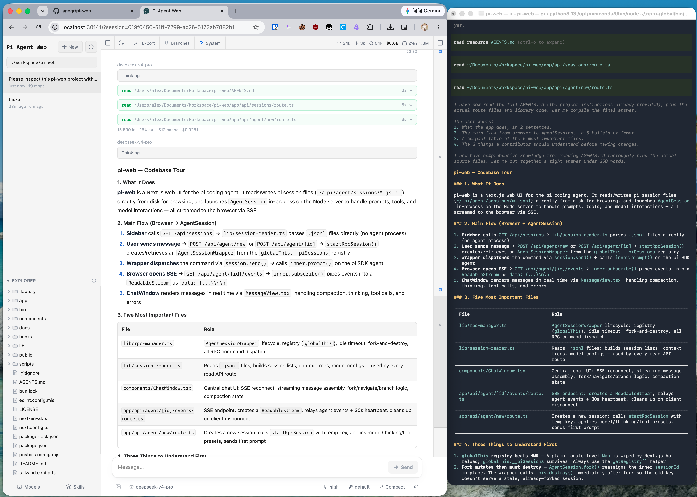

# Pi Web

[English](../README.md) | [中文文档](./README.zh-CN.md) | [日本語](./README.ja.md)

Локальный браузерный интерфейс для [pi coding agent](https://github.com/earendil-works/pi). Pi Web использует те же локальные настройки и файлы сессий, что и pi, поэтому в браузере можно находить и продолжать диалоги, запускать агента, настраивать модели и ресурсы, а также просматривать файлы проекта.




## Polyforge

Pi Web — веб-рабочее место для [Polyforge](https://github.com/silgrid/polyforge), командной системы координации и памяти для нескольких агентов программирования. Если на машине установлен локальный `pf`, панель Polyforge в Pi Web показывает рабочие элементы, задания с графом шагов и ходом выполнения, память проекта и сообщения. Pi Web работает и без Polyforge; чтобы установить `pf`, воспользуйтесь установщиком из README Polyforge.

## Возможности

- **Рабочее пространство сессий**: просмотр, продолжение, переименование, экспорт и удаление диалогов, сгруппированных по проектам, с отображением состояния выполнения, использования контекста, стоимости и сведений о сжатии.
- **Два способа создать ветку**: **New session** создаёт независимый файл сессии из более раннего сообщения, а **Edit from here** создаёт ветку внутри текущей сессии.
- **Инструменты для файлов проекта**: просмотр и загрузка файлов, проверка Git Diff, предпросмотр исходного кода, Markdown, изображений, аудио, PDF и DOCX с автоматическим обновлением.
- **Настройка через Web**: управление входом в Provider и API Key, моделями, тестами моделей, пакетами плагинов и навыками без выхода из Pi Web.
- **Панель Polyforge**: если на машине установлен `pf`, кнопка в верхней панели открывает док-панель Polyforge (на телефоне — нижнюю шторку): карточки Jobs и подробности задания с графом шагов и ходом выполнения всего задания, Tasks, список рабочих элементов (工单列表), Memory проекта и Messages с контактами, сгруппированными по проектам, управлением участниками, сворачиваемой колонкой контактов и карточкой анализа сообщения (тип, сводка и действия «завести тикет» / «ответить»). Подробнее — в [agents/polyforge-panel.md](./agents/polyforge-panel.md).
- **Сессии claude**: в новом окне ввода выбор харнесса (pi или claude) стоит рядом с выбором модели; при выборе claude в нём псевдонимы моделей, которые сообщает claude из вашего PATH (например, `default`, `opus`, `sonnet`, `haiku`), и добавленные вами собственные имена моделей. Фиксирован только харнесс: открытая сессия claude в простое переключает модель и effort и сжимает контекст собственной командой claude `/compact`. Запускается системный claude с вашими собственными настройками, входом и `CLAUDE.md` (об этом говорит подсказка под выбором) — без отдельного каталога конфигурации и без наборов инструментов. Подробнее — в [agents/claude-sessions.md](./agents/claude-sessions.md).
- **Интерфейс на английском, упрощённом и традиционном китайском**: при первом запуске Pi Web учитывает язык браузера, а затем язык можно переключить в верхней панели.

## Быстрый старт

> **⚠️ Предупреждение об открытии доступа.** По умолчанию `npx` / `pi-web` прослушивают только `127.0.0.1`. `pi-web -H 0.0.0.0` / `npm run start:lan` открывают приложение **без аутентификации**, если не задана переменная `PI_WEB_PASSWORD`: любой, кто может достучаться до порта, сможет читать и изменять файлы, открывать терминал и управлять агентом. `deploy-piweb.sh` по умолчанию привязывается к `0.0.0.0`, но теперь отказывает в развёртывании на не-loopback-адресе без `PIWEB_PORT` и `PI_WEB_PASSWORD`, поэтому не запускает сервис без пароля. Перед открытием порта задайте `PI_WEB_PASSWORD` (или оставьте привязку к loopback-адресу / используйте доверенный reverse-proxy).

Для работы Pi Web требуется Node.js 22.19.0 или новее. Проверьте версию командой `node --version`, затем выполните:

```bash
npx @silgrid/pi-web@latest
```

Когда сервер будет готов, CLI попытается открыть браузер автоматически. Если этого не произошло, откройте [http://127.0.0.1:30141](http://127.0.0.1:30141). По умолчанию Pi Web прослушивает только `127.0.0.1`.

Если Provider модели ещё не настроен, откройте панель **Models**, войдите в учётную запись или добавьте API Key.

Чтобы установить команду `pi-web` глобально:

```bash
npm install -g @silgrid/pi-web@latest
pi-web
```

Команды:

```bash
pi-web version          # вывести установленную версию
pi-web status           # список запущенных серверов
pi-web stop [--port N]  # остановить запущенный сервер
pi-web open [--port N]  # открыть запущенный сервер в браузере
pi-web update [--check] # обновить глобальную установку из канала выпусков
```

Для обновления остановите запущенный процесс с помощью `Ctrl+C` и выполните `pi-web update`. Обновление идёт из канала выпусков, указанного в поставляемом файле `bin/pi-web-release-channel.json` (`{ "repo": "OWNER/REPO" }`): если это собственный репозиторий пакета (`silgrid/pi-web`), устанавливается `@silgrid/pi-web@latest` из npm — так же, как при повторном запуске команды установки; любой другой репозиторий — линия GitHub Releases, которая обновляется из GitHub Releases этого репозитория (GitHub CLI `gh` скачивает `.tgz` выпуска и `SHA256SUMS`, контрольная сумма проверяется, затем `npm install -g` устанавливает архив). `pi-web update --check` только сообщает канал и последнюю версию, ничего не скачивая и не устанавливая. Дерево без корректного маркера (например, пакет из upstream или скопированный) отклоняется с ненулевым кодом выхода до какой-либо загрузки или установки. Маркер этого дерева указывает на репозиторий Polyforge: Pi Web разрабатывается в каталоге `pi-web/` этого репозитория, и каждый выпуск Polyforge содержит архив Pi Web (`silgrid-pi-web-<tag>.tgz`) и `SHA256SUMS` рядом с `pf`, поэтому `pi-web update` следует тому же тегу, что и `pf`. Для удаления выполните `npm uninstall -g @silgrid/pi-web`.

## Настройка

Для порта и имени хоста параметры командной строки имеют приоритет над соответствующими переменными окружения. И `--no-open`, и `PI_WEB_NO_OPEN=1` отключают автоматическое открытие браузера независимо друг от друга. `pi-web --help` (или `-h`) выводит параметры запуска и завершает работу без старта сервера. Неизвестные параметры завершают процесс с ошибкой.

| Параметр или переменная окружения | Назначение | Значение по умолчанию |
| --- | --- | --- |
| `--help`, `-h` | Показать параметры запуска и выйти | — |
| `--port <port>`, `-p <port>` или `PORT` | Порт сервера | `30141` |
| `--hostname <host>`, `-H <host>` или `PI_WEB_HOSTNAME` | Имя хоста для привязки | `127.0.0.1` |
| `--no-open` или `PI_WEB_NO_OPEN=1` | Не открывать браузер автоматически | Браузер открывается |
| `PI_WEB_ALLOWED_HOSTS` | Дополнительные точные имена прокси или пользовательских хостов через запятую | Не задано |
| `PI_WEB_PASSWORD` | Включить вход по паролю в браузере; API также поддерживает Basic Auth с именем `pi` | Аутентификация отключена |

Пример:

```bash
pi-web --help
pi-web -p 8080 -H 0.0.0.0 --no-open
```

### Удалённый доступ

Привязка к адресу, отличному от loopback, открывает сетевой доступ к агенту, способному выполнять операции с широкими полномочиями. Даже в доверенной локальной сети используйте длинный случайный пароль:

```bash
PI_WEB_PASSWORD='длинный-случайный-пароль' pi-web --hostname 0.0.0.0
```

Парольная аутентификация не шифрует соединение. Не публикуйте Pi Web в интернете по обычному HTTP; используйте HTTPS через доверенный обратный прокси или надёжное VPN-подключение. Если обратный прокси передаёт внешнее имя хоста, добавьте это точное имя в `PI_WEB_ALLOWED_HOSTS`. Этот список разрешённых имён не меняет адрес, к которому привязывается Pi Web.

### HTTP-прокси

Для серверных запросов к моделям и API используются стандартные переменные окружения `HTTP_PROXY`, `HTTPS_PROXY` и `NO_PROXY`.

В macOS и Linux:

```bash
HTTP_PROXY=http://127.0.0.1:7890 \
HTTPS_PROXY=http://127.0.0.1:7890 \
NO_PROXY=localhost,127.0.0.1 \
npx @silgrid/pi-web@latest
```

В Windows PowerShell:

```powershell
$env:HTTP_PROXY = "http://127.0.0.1:7890"
$env:HTTPS_PROXY = "http://127.0.0.1:7890"
$env:NO_PROXY = "localhost,127.0.0.1"
npx @silgrid/pi-web@latest
```

## Примечания

- **Данные агента**: по умолчанию Pi Web читает данные pi из `~/.pi/agent`, включая файлы сессий в `sessions/<encoded-cwd>/<timestamp>_<uuid>.jsonl`. Чтобы использовать другой каталог агента pi, задайте `PI_CODING_AGENT_DIR`.
- **Доступ к файловой системе**: Pi Web должен иметь доступ для чтения к каталогу данных агента и рабочим каталогам, записанным в сессиях. При совместном использовании существующих сессий запускайте Pi Web в той же файловой среде, что и pi.
- **Общие настройки**: панель Models использует хранилища моделей, настроек и учётных данных pi, поэтому изменения видны в обоих интерфейсах.
- **Граница доступа к файлам**: файловый браузер ограничен рабочими каталогами, выбранными в Pi Web, и уже известными корнями проектов или сессий; это не универсальный файловый менеджер.

## Разработка

```bash
npm install
npm run dev
```

Сервер разработки доступен по адресу [http://127.0.0.1:30141](http://127.0.0.1:30141). Основные проверки запускаются командами:

```bash
npm test
node_modules/.bin/tsc --noEmit
npm run lint
```

Не запускайте `next build` или `npm run build` во время обычной разработки. Эти команды записывают данные в `.next/` и могут помешать работе сервера разработки; выполняйте сборку только при подготовке релиза.

Прежде чем браться за новую функцию, прочитайте [Contributing](../CONTRIBUTING.md): там описано, какие изменения входят в рамки проекта, и что проверить перед pull request.

Руководства для участников: [Internationalization](./i18n.md) и [Release process](./release.md).

## Структура репозитория

```text
app/             UI Next.js и маршруты API
components/      Компоненты интерфейса React
hooks/           Состояние клиента и обработчики взаимодействий
lib/             Логика сессий, агента, моделей, файлов, Git и безопасности
public/          Статические ресурсы и файлы PWA
bin/             Точка входа npm CLI и разбор параметров запуска
docs/            Тематические руководства для пользователей и участников
```

Описание архитектуры и подробная карта файлов приведены в [AGENTS.md](../AGENTS.md).

## Лицензия

[MIT](../LICENSE)
