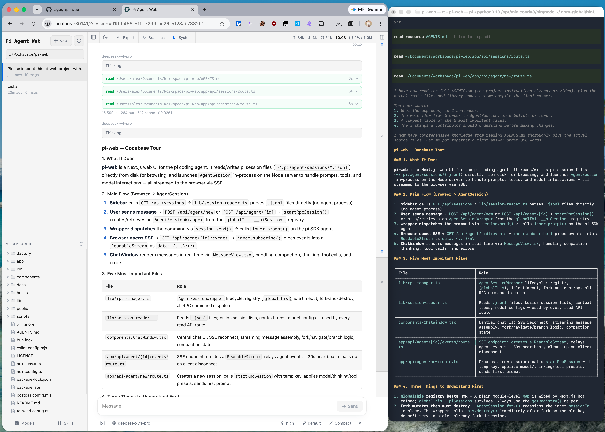

# Pi Web

[English](../README.md) | [日本語](./README.ja.md) | [Русский](./README.ru.md)

[pi 编程智能体](https://github.com/earendil-works/pi)的本地浏览器界面。Pi Web 与 pi 共用本机配置和会话文件，可在浏览器中查找和继续对话、运行智能体、配置模型与资源，并查看项目文件。




## Polyforge

Pi Web 是 [Polyforge](https://github.com/silgrid/polyforge) 的 Web 工作台；Polyforge 是面向编程智能体的团队级多智能体协作与记忆系统。本机装有 `pf` 时，Pi Web 的 Polyforge 面板可查看工单、作业及其步骤图与执行进度、项目记忆和消息。Pi Web 不依赖 Polyforge 也能使用；安装 `pf` 请按 Polyforge README 中的安装说明进行。

## 功能

- **会话工作区**：按项目查找、继续、重命名、导出和删除对话，并查看运行状态、上下文占用、花费和压缩信息。
- **两种分支方式**：**新会话**会从较早的消息创建独立会话文件；**从此处编辑**会在当前会话内创建分支。
- **项目文件工具**：浏览和上传文件、查看 Git Diff，并预览源码、Markdown、图片、音频、PDF 和 DOCX；文件变化后会自动刷新。
- **网页配置**：无需离开 Pi Web，即可管理 Provider 登录和 API Key、模型、模型测试、插件包及技能。
- **Polyforge 面板**：本机装有 `pf` 时，顶部栏按钮会打开 Polyforge 停靠面板（手机上为底部抽屉）：Jobs 卡片与作业详情（步骤图和整个作业的执行进度）、Tasks、工单列表、项目 Memory，以及按项目分组联系人并可管理成员、联系人列可折叠、每条消息可生成分析卡片（类型、摘要与【建票】/【回复】操作）的 Messages。详见 [agents/polyforge-panel.md](./agents/polyforge-panel.md)。
- **claude 会话**：新建会话的 harness 选择器（pi 或 claude）位于模型选择器旁；选择 claude 时模型选择器列出 PATH 上的 claude 报告的模型别名（如 `default`、`opus`、`sonnet`、`haiku`），以及你添加的自定义模型名。只有 harness 固定不变：已打开的 claude 会话可在空闲时切换模型和 effort，并用 claude 自己的 `/compact` 压缩上下文。claude 会话运行系统 claude，使用你自己的配置、登录和 `CLAUDE.md`（选择器下方有提示）——没有专用配置目录，也没有工具预设。详见 [agents/claude-sessions.md](./agents/claude-sessions.md)。
- **英文、简体中文和繁体中文界面**：Pi Web 首次打开时跟随浏览器语言，也可从顶部栏切换语言。

## 快速开始

> **⚠️ 暴露警告。** `pi-web` 默认仅监听 `127.0.0.1`。`pi-web -H 0.0.0.0` / `npm run start:lan` 在未设置 `PI_WEB_PASSWORD` 时会让应用在**无认证**状态下对外暴露：任何能访问该端口的人都可以读写文件、打开终端并操控 agent。`deploy-piweb.sh` 默认绑定 `0.0.0.0`，但现在会拒绝缺少 `PIWEB_PORT` 或 `PI_WEB_PASSWORD` 的非回环部署，因此不会再启动无密码服务。对外暴露端口前，请先设置 `PI_WEB_PASSWORD`（或保持仅监听回环地址 / 使用可信的边缘代理）。

Pi Web 要求 Node.js 22.19.0 或更高版本（用 `node --version` 检查版本）。Pi Web 只随 Polyforge 的 GitHub Release 发布——即与 `pf` 同列的 `silgrid-pi-web-<tag>.tgz` 资产及其 `SHA256SUMS` 行——由 Polyforge 安装脚本的 `--with-pi-web` 安装，不从 npm 安装：见[安装：web 工作台](https://github.com/silgrid/polyforge/blob/main/docs/install.md#optional-the-web-workbench-pi-web)。安装后运行：

```bash
pi-web
```

服务就绪后，命令行会尝试自动打开浏览器。如果没有打开，请访问 [http://127.0.0.1:30141](http://127.0.0.1:30141)。Pi Web 默认仅监听 `127.0.0.1`。

如果尚未配置模型 Provider，请打开**模型（Models）**面板登录或添加 API Key。

安装脚本装好 tarball 后会运行包内自带的安装检查；如需手动再运行一次：

```bash
node "$(npm root -g)/@silgrid/pi-web/bin/pi-web-install-check.js"
```

命令：

```bash
pi-web version          # 打印已安装的版本
pi-web status           # 列出正在运行的服务
pi-web stop [--port N]  # 停止正在运行的服务
pi-web open [--port N]  # 在浏览器中打开正在运行的服务
pi-web update [--check] # 从发布通道更新全局安装
```

更新时先用 `Ctrl+C` 停止正在运行的进程，再运行 `pi-web update`。它从随包发布的 `bin/pi-web-release-channel.json`（`{ "repo": "OWNER/REPO" }`）指定的发布通道更新：该仓库是本包自己的仓库（`silgrid/pi-web`）时，从 npm 安装 `@silgrid/pi-web@latest`，与重新执行安装命令相同；其他任何仓库都是 GitHub Releases 线，从该仓库的 GitHub Releases 更新（GitHub CLI `gh` 下载发布的 `.tgz` 与 `SHA256SUMS`，校验通过后用 `npm install -g` 安装该 tarball）。`pi-web update --check` 只报告通道和最新版本，不下载也不安装任何内容。没有有效标记文件的安装树（例如上游或复制来的包）会在获取或安装任何内容之前以非零退出码拒绝。本安装树的标记文件指向 Polyforge 仓库：Pi Web 在该仓库的 `pi-web/` 目录中开发，每个 Polyforge 发布都在 `pf` 旁附带 Pi Web 的 tarball（`silgrid-pi-web-<tag>.tgz`）和 `SHA256SUMS`，因此 `pi-web update` 与 `pf` 跟随同一个 tag。卸载时运行 `npm uninstall -g @silgrid/pi-web`。

## 配置

端口和主机名以命令行参数为准，优先于对应的环境变量。`--no-open` 与 `PI_WEB_NO_OPEN=1` 中任意一个都会关闭自动打开浏览器。运行 `pi-web --help`（或 `-h`）可打印启动选项并以退出码 0 结束，不会启动服务；未知参数会报错并以退出码 1 结束。

| 参数或环境变量 | 用途 | 默认值 |
| --- | --- | --- |
| `--help`、`-h` | 打印启动选项并退出 | — |
| `--port <端口>`、`-p <端口>` 或 `PORT` | 服务端口 | `30141` |
| `--hostname <主机>`、`-H <主机>` 或 `PI_WEB_HOSTNAME` | 监听主机名 | `127.0.0.1` |
| `--no-open` 或 `PI_WEB_NO_OPEN=1` | 不自动打开浏览器 | 自动打开 |
| `PI_WEB_APP_NAME` | PWA manifest 的 `name` 和 `short_name`；去除首尾空白，空值使用默认值 | `Pi Web` |
| `PI_WEB_ALLOWED_HOSTS` | 额外允许的代理或自定义主机名，多个值用逗号分隔，必须精确匹配 | 未设置 |
| `PI_WEB_PASSWORD` | 启用浏览器密码登录；API 客户端可使用用户名为 `pi` 的 Basic Auth | 不启用认证 |

在启动服务前设置 `PI_WEB_APP_NAME`，例如 `PI_WEB_APP_NAME='工作 Pi' pi-web`。修改后重启服务即可提供新的 manifest，无需重新构建。已安装 PWA 的名称更新由浏览器管理，不保证立即生效；此设置不改变页面标题或图标。

例如：

```bash
pi-web --help
pi-web -p 8080 -H 0.0.0.0 --no-open
```

### 远程访问

监听非回环地址会暴露一个可执行高权限操作的智能体。在可信局域网中使用时，请设置足够长的随机密码：

```bash
PI_WEB_PASSWORD='足够长的随机密码' pi-web --hostname 0.0.0.0
```

密码认证不会加密连接。不要通过明文 HTTP 将 Pi Web 暴露到互联网；远程访问应使用可信反向代理提供 HTTPS，或通过可信 VPN。如果反向代理传递外部主机名，请把该名称精确加入 `PI_WEB_ALLOWED_HOSTS`。这个白名单不会改变 Pi Web 的监听地址。

### HTTP 代理

服务端的模型和 API 请求会读取标准的 `HTTP_PROXY`、`HTTPS_PROXY` 和 `NO_PROXY` 环境变量。

macOS 或 Linux：

```bash
HTTP_PROXY=http://127.0.0.1:7890 \
HTTPS_PROXY=http://127.0.0.1:7890 \
NO_PROXY=localhost,127.0.0.1 \
pi-web
```

Windows PowerShell：

```powershell
$env:HTTP_PROXY = "http://127.0.0.1:7890"
$env:HTTPS_PROXY = "http://127.0.0.1:7890"
$env:NO_PROXY = "localhost,127.0.0.1"
pi-web
```

## 注意事项

- **智能体数据**：Pi Web 默认读取 `~/.pi/agent` 下的 pi 数据，包括 `sessions/<编码后的工作目录>/<时间戳>_<uuid>.jsonl` 中的会话文件。可通过 `PI_CODING_AGENT_DIR` 指定其他 pi agent 目录。
- **文件系统访问**：Pi Web 必须能读取智能体数据目录及会话记录中的工作目录。与现有 pi 会话共用数据时，请让 Pi Web 运行在与 pi 相同的文件系统环境中。
- **共享配置**：模型面板使用 pi 的模型、设置和凭据存储，因此两种界面都能看到相关更改。
- **文件访问边界**：文件浏览器仅能访问在 Pi Web 中选择过的工作目录，以及它已识别的项目或会话根目录；它不是通用的文件系统浏览器。

## 开发

```bash
npm install
npm run dev
```

开发服务器运行在 [http://127.0.0.1:30141](http://127.0.0.1:30141)。常用检查命令：

```bash
npm test
node_modules/.bin/tsc --noEmit
npm run lint
```

日常开发时不要运行 `next build` 或 `npm run build`。它们会写入 `.next/`，可能干扰开发服务器；仅在发布流程中执行构建。

开始做新功能之前，请先阅读[参与贡献](./CONTRIBUTING.zh-CN.md)，了解哪些改动在范围内以及提交 PR 前的检查项。

贡献者文档：[国际化](./i18n.md)和[发布流程](./release.md)。

## 仓库结构

```text
app/             Next.js 界面和 API 路由
components/      React 界面组件
hooks/           客户端状态和交互 hooks
lib/             会话、智能体、模型、文件、Git 和安全逻辑
public/          静态资源和 PWA 文件
bin/             npm CLI 入口及启动参数解析
docs/            面向用户和贡献者的专题文档
```

架构说明和详细文件地图见 [AGENTS.md](../AGENTS.md)。

## 许可证

[MIT](../LICENSE)
